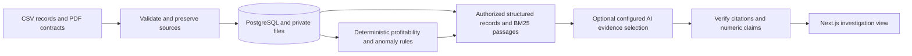

# ProfitLens

**Investigate changes in customer profitability and trace findings back to business records.**

ProfitLens is a 12-week B.Tech COM-711 group project building a business intelligence web application for small and growing businesses. It connects customer records, invoices, attributed expenses and PDF contracts with deterministic contribution/margin calculations, reviewable discrepancies and permission-scoped evidence investigations.

> **Implementation update — 15 October 2026.** The data workspace includes profitability, cost-completeness review, financial discrepancy rules, page-attributed BM25 retrieval, extractive investigations and an in-popup AI conversation with current customer/month evidence. Live OpenRouter chat smoke checks passed; systematic model-quality evaluation and container deployment remain unverified. Semantic embeddings/pgvector and quantization are not implemented. [Current results and limitations](docs/ROADMAP_IMPLEMENTATION_REPORT.md).

## The problem it addresses

A business may have an updated contract price in a PDF, recent invoices in a spreadsheet, and customer costs in another file. Seeing a falling margin is useful; identifying the records behind that change is more useful. ProfitLens is designed to connect those records and let a user review a calculation and its sources before acting.

The intended investigation path is:

1. **Validate** customer, invoice, expense, and contract inputs, retaining source rows and PDF pages.
2. **Calculate** net billed revenue, attributed costs, contribution, and margin using deterministic rules.
3. **Flag** pricing mismatches, unusual cost increases, and margin declines with traceable inputs.
4. **Retrieve** relevant records and contract passages within the user's organization and customer permissions.
5. **Explain** a finding in plain language with checked source references, limitations, and suggestions for human review.

## What works today

| Capability | Current behavior |
| --- | --- |
| Secure workspace | Local accounts, expiring server-side sessions, admin/finance/analyst roles, organization isolation and assigned-customer access. |
| Business records | Create, inspect and update customers, invoices and expenses with exact decimal validation and retained provenance. |
| CSV imports | Preview row errors; confirm valid records atomically; reject conflicts; safely retry without duplicates. |
| Private contracts | Upload/download text-based PDFs, inspect page evidence and manually review fixed monthly pricing and effective dates. |
| Revenue & costs | Customer/month report with Decimal arithmetic, tax exclusion, source lines, missing-data and contract-period warnings. [Rules and limits](docs/FINANCIAL_RULES.md). |
| Team access | Administrators assign customers to read-only analysts; changes apply to subsequent API requests. |
| Presentation | Responsive liquid-glass interface ("Panes in Depth") in light and dark themes: record summaries with source previews, a WebGL background, an intro on every visit, optional interface sounds, animated typing, reduced-motion support and keyboard navigation. |
| Profitability | Decimal contribution/margin, input-bound cost attestations and configurable pricing/cost/margin rules with sources. |
| Evidence investigations | Customer/period-filtered BM25 retrieval, strict OpenRouter/NVIDIA provider adapter, numeric/quote checks, insufficient-evidence states and scoped history. Hosted model requires separate configuration. |
| Reproducibility | Synthetic CSV/PDF fixtures, migrations, pinned dependencies, regression tests and a frozen 30-question retrieval comparison. See the current verification report for actual results. |

## Run the web application

On Windows, after the one-time setup, double-click **`dev.cmd`**. Choose **1** to start the frontend and API with automatic reload, **2** to stop them, or **0** to close the launcher. Open **http://localhost:3000** after startup.

Use the [development guide](docs/DEVELOPMENT.md) for database setup, migrations, account provisioning and startup. The frontend runs at `http://localhost:3000`; FastAPI runs on port 8000. No AI API key is required for the completed data-management features.

```text
Browser → Next.js workspace → FastAPI authorization → PostgreSQL
                                      └────────────→ Private contract files
```

For a live demonstration, follow the [Presentation guide](docs/DEMO.md). It explains the verified workflow, synthetic data, intro controls and current limits.

`seed-demo` now prepares twelve months of synthetic record activity, private contract documents and import history. For an existing prepared workspace, run `.\.venv\Scripts\python.exe -m profitlens.manage seed-presentation`, then Refresh in the app. The setup preserves existing edits and access grants; it runs only when explicitly requested, not on every server start.

Ready-to-upload files are in **[demo-files](demo-files/README.md)**: five fictional customers, six months of invoices and expenses, three contract PDFs, and intentional validation/retry examples. The included guide explains the import order and expected results.

The optional [real-data demo guide](docs/REAL_DATA_DEMO.md) documents two separately provisioned local workspaces: licensed public council expenses in GBP and fictional financial investigations in INR. It includes source attribution, honest data gaps and a new-import pack for a teacher demonstration. Downloaded records and local credentials are Git-ignored.

See [workspace access and import guarantees](docs/SECURITY_AND_IMPORTS.md) for role behavior, transaction boundaries, retries and record provenance.

## Investigation architecture



Financial arithmetic and discrepancy rules run in Python, independently of AI. Investigations render checked extractive explanations. The popup chat supports automatic, permission-scoped workspace questions, optional manual filters, formatted financial cards and links into records: the backend supplies figures and source excerpts and checks references, while the AI's interpretation remains subject to human review. Customer/month permissions apply before retrieval and are checked again after generation. PostgreSQL stores records, passages and investigation snapshots; there is no vector index in this release. [Chat behavior and limits](docs/ANALYSIS_GUIDE.md). [Architecture and trust boundaries](docs/ARCHITECTURE.md).

## Try the Week 1 preview

Install Python 3.12 or later. From a PowerShell terminal in the repository root:

```powershell
python -m venv .venv
.\.venv\Scripts\python.exe -m pip install -e .
.\.venv\Scripts\python.exe -m profitlens.ingestion.preview --organization-id demo-org --customers data/demo/customers.csv --invoices data/demo/invoices.csv --expenses data/demo/expenses.csv
.\.venv\Scripts\python.exe -m unittest discover -s tests -v
```

The CLI prints a JSON report with `valid`, record counts, customer-period links, warnings, errors, and `persisted: false`. To inspect a text-based contract PDF, add `--contract-pdf path/to/contract.pdf --contract-customer-id C001` to the preview command. The PDF must have selectable text; the current parser does not perform OCR. On macOS/Linux, activate `.venv` and use `python` in place of the Windows `.venv` executable.

## Delivery approach

The twelve-week roadmap builds storage and authentication first, then financial rules, retrieval, verified explanations and evaluation. The [progress record](docs/ROADMAP.md) separates implemented modules from unverified external integrations. Multi-industry expansion is outside this delivery.

The reproducible evaluation uses 20 synthetic customers, six months of records, current/expired contract pairs and 30 questions. It measures financial correctness, rule precision/recall and retrieval ranking against a permission-preserving baseline. Quantization is deferred: the current retrieval engine has no pretrained weights to quantize. Human relevance assessment and live model quality remain future validation work.

Open **Profitability & evidence** to load a customer/month, inspect sources, attest complete costs, search reviewed contracts and request a verified investigation. [Setup, demo and API reference](docs/ANALYSIS_GUIDE.md). [Deployment preparation](docs/DEPLOYMENT.md).

## Repository guide

| Path | Purpose |
| --- | --- |
| `apps/api/profitlens/` | FastAPI, access rules, persistent imports, data models and the original ingestion CLI. |
| `apps/web/` | Next.js/TypeScript workspace and Playwright browser tests. |
| `migrations/` | Versioned PostgreSQL schema. |
| [Development guide](docs/DEVELOPMENT.md) | Local setup, demo accounts, test commands and operational limits. |
| `data/demo/` | Original synthetic input examples. |
| [Teacher demo files](demo-files/README.md) | Ready-to-upload CSVs and PDFs, validation examples and a short walkthrough. |
| `tests/` | Focused behavior tests; also run by GitHub Actions. |
| [Project brief](docs/PROJECT_BRIEF.md) | Problem, academic contribution, scope, and acceptance evidence. |
| [Architecture](docs/ARCHITECTURE.md) | Planned components, provenance, security, and financial boundaries. |
| [Data contracts](docs/DATA_CONTRACTS.md) | Supported Week 1 CSV fields and amount semantics. |
| [Progress](docs/ROADMAP.md) | Completed milestones and current limitations. |

## Scope and use

ProfitLens is a decision-support prototype. It is not an accounting authority or payment system. Estimated opportunities need human review, and results depend on the completeness of supplied data. The college demo uses synthetic records; real customer data and secrets must not be committed. The code is publicly viewable, while [LICENSE.md](LICENSE.md) reserves reuse rights.

The project is being developed by a team. Project idea and copyright: Karan Kirti Sharma.
