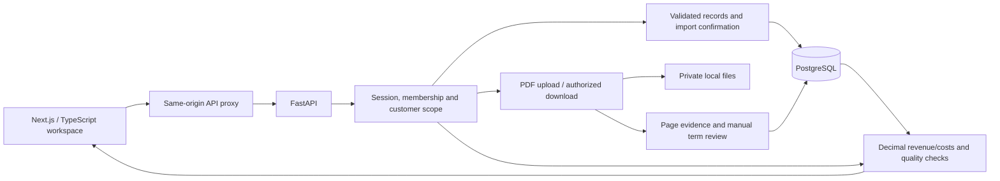
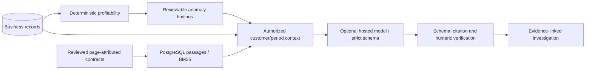

# ProfitLens architecture

Deployment follow-up (15 October 2026): the optional [free hosted demo](VERCEL_FREE_DEPLOYMENT.md) keeps this application architecture, adds private Vercel Blob persistence and uses Neon through a pooled TLS URL. Local disk storage remains the default. Cloud integration is prepared and locally tested, not yet verified on a live deployment.

**Current implementation (15 October 2026):** authenticated workspaces, imports/private contracts, exact financial analysis, cost reviews, financial discrepancy rules, lexical retrieval and verified extractive investigation integration. Live provider quality and Docker deployment are unverified; see the [implementation report](ROADMAP_IMPLEMENTATION_REPORT.md).

## Implemented data foundation



FastAPI is the trust boundary. The Next.js proxy keeps browser requests on one origin; it has no database credentials. API dependencies resolve session/membership scope before querying records. Composite organization/customer foreign keys protect relationships. Business writes use PostgreSQL transactions, with successful commit before a success response is sent.

SQLAlchemy Core defines the relational schema; Alembic carries a frozen initial migration. Organization-scoped tables hold customers, invoices, expenses, import batches, customer grants, contracts and audit events. Authentication tables hold users, memberships, hashed opaque sessions and login attempt limits. `NUMERIC(14,2)` and Python Decimal preserve amounts; API values are decimal strings.

CSV preview validates one file type at a time and stores a reviewable batch. Confirmation locks the workspace, checks current data and commits all rows together. Fingerprints and scoped primary keys prevent duplicate writes. Original row provenance survives subsequent edits, which append audit events. The original command-line bundle preview remains available and does not persist records.

PDF files live outside the web root and have generated storage names. Authorized API requests return files; no static directory serves uploads. Extracted page text is unverified evidence. Reviewed monthly terms include effective dates, rate/discount, currency, source page and reviewer. [Read the access and import guarantees](SECURITY_AND_IMPORTS.md).

## Implemented investigation pipeline



`profitability.py` extends the Week 4 engine without replacing it. `retrieval.py` indexes overlapping 1,200-character page chunks and ranks authorized candidates with BM25. Context mode filters reviewed contracts to cover the full month; baseline mode removes only that temporal/review filter, retaining tenant/customer authorization. No vector extension or neural embedding model is used.

`explanations.py` builds a bounded evidence pack and calls a fixed-host OpenRouter or NVIDIA adapter only when configured and sufficient evidence exists. JSON schema permits metric claims, finding IDs and exact quotations, not unconstrained narrative. Decimal values/units, known IDs and quote substrings are verified before the server renders a readable summary. Unsupported output is withheld. This verifies provenance and arithmetic, not semantic relevance or causation.

`analysis_api.py` releases the database connection before provider I/O and rechecks session, customer permissions and the evidence hash afterward. Changes during generation return 409; lost access returns 401/404. Saved investigations are scoped on every read and hide results when current evidence differs. Five investigation requests per workspace/minute limit accidental provider usage. Private PDFs remain available only through authorized downloads.

The additive `20261015_roadmap` migration creates `cost_reviews`, `document_passages` and `investigations`, with organization/customer foreign keys. Expense-value hashes invalidate cost attestations; chunk IDs include contract/page/position/content/index version. Model output and evidence snapshots stay in PostgreSQL, not public assets. The browser never receives a provider key.

## Financial boundary

Invoice subtotal is before discount and excludes tax. Net billed revenue is `subtotal - discount - refund`. Contribution is revenue minus recorded direct costs; margin is contribution/revenue × 100 only for positive revenue. Missing inputs remain unavailable. Results are provisional until an authorized cost attestation matches the exact current expense inputs. Pricing compares pre-refund billed charges with unique reviewed fixed monthly terms; prior/current cost and margin comparisons require complete-cost attestations for both months. See [financial rules](FINANCIAL_RULES.md) and [analysis guide](ANALYSIS_GUIDE.md).

## Repository layout

```text
apps/api/profitlens/           FastAPI, schema, access, records and imports
apps/api/profitlens/ingestion/ Original CSV/PDF validation and preview CLI
apps/web/                     Next.js UI, shared components and browser tests
migrations/                   Alembic schema revisions
scripts/                      Synthetic fixtures and local/test startup
data/demo/                    Synthetic CSVs and text-based PDFs
docs/                         Scope, architecture, setup and verified progress
tests/                        Ingestion and PostgreSQL/API behavior tests
```

[Development](DEVELOPMENT.md) records runtime choices. [Deployment](DEPLOYMENT.md) covers private persistent volumes, migration/backup steps and the unverified container boundary. [Progress](ROADMAP.md) records milestone verification.
