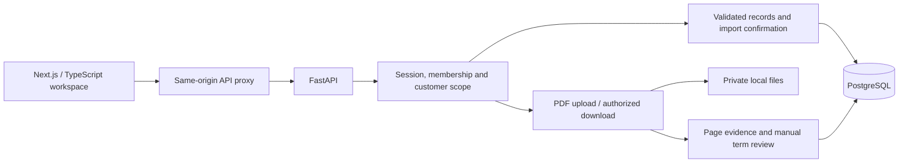
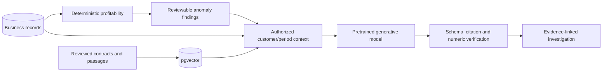

# ProfitLens architecture

**Implemented through Week 3:** authenticated workspaces, organization/customer authorization, business records, transactional imports and private contract review. Financial calculations, findings, retrieval and AI investigation remain later stages.

## Implemented data foundation



FastAPI is the trust boundary. The Next.js proxy keeps browser requests on one origin; it has no database credentials. API dependencies resolve session/membership scope before querying records. Composite organization/customer foreign keys protect relationships. Business writes use PostgreSQL transactions, with successful commit before a success response is sent.

SQLAlchemy Core defines the relational schema; Alembic carries a frozen initial migration. Organization-scoped tables hold customers, invoices, expenses, import batches, customer grants, contracts and audit events. Authentication tables hold users, memberships, hashed opaque sessions and login attempt limits. `NUMERIC(14,2)` and Python Decimal preserve amounts; API values are decimal strings.

CSV preview validates one file type at a time and stores a reviewable batch. Confirmation locks the workspace, checks current data and commits all rows together. Fingerprints and scoped primary keys prevent duplicate writes. Original row provenance survives subsequent edits, which append audit events. The original command-line bundle preview remains available and does not persist records.

PDF files live outside the web root and have generated storage names. Authorized API requests return files; no static directory serves uploads. Extracted page text is unverified evidence. Reviewed monthly terms include effective dates, rate/discount, currency, source page and reviewer. [Read the access and import guarantees](SECURITY_AND_IMPORTS.md).

## Target investigation pipeline



These investigation components are planned. The AI provider will receive only authorized context and cannot create authoritative financial values or approve access. Contract content is evidence, never an instruction to the application. Citation validity does not prove semantic support; the later evaluation will check both. Unsupported or missing evidence must produce a visible limitation.

## Financial boundary for the next stage

Invoice `subtotal` is before discount and excludes tax. Supported `refund` is a pre-tax reduction in the same period. Net billed revenue will be `subtotal - discount - refund`; tax is excluded. Attributed costs join by customer and billing period. Contribution will be revenue minus attributed cost; margin is contribution divided by revenue only when revenue is positive. Missing expenses do not establish zero cost. Unsupported credits, duplicates and unmatched periods require explicit handling. See [data contracts](DATA_CONTRACTS.md).

## Repository layout

```text
apps/api/profitlens/           FastAPI, schema, access, records and imports
apps/api/profitlens/ingestion/ Original CSV/PDF validation and preview CLI
apps/web/                     Next.js UI, shared components and browser tests
migrations/                   Alembic schema revisions
scripts/                      Synthetic fixtures and local/test startup
data/demo/                    Synthetic CSVs and text-based PDFs
docs/                         Scope, architecture, setup and verified progress
tests/                        Ingestion and PostgreSQL/API behavior tests
```

[Development](DEVELOPMENT.md) records runtime choices and commands. [Progress](ROADMAP.md) records actual milestone verification. Local file storage and account provisioning suit the current prototype; deployment, recovery, backups and hosting integration need the later deployment milestone.
