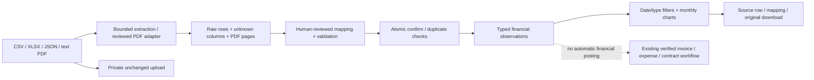

# Source-first compatibility release — 16 October 2026

## Audit and direction

The current implementation was already beyond Week 4: persistent imports, permission-scoped customer profitability, cost reviews, contract retrieval and checked AI chat exist. The incompatibility was semantic, not simply a missing chart: every invoice required a complete tax/discount/refund breakdown, every expense required a customer, PDF uploads were treated as customer contracts, and the overview presented four fixed entity types. Public procurement sources have none of those customer relationships. The FHDC source even contains a negative credit and has PDF bytes despite a CSV filename.

Keep the existing verified financial workflow and add a source-first ingestion boundary in the same FastAPI/PostgreSQL application. Source observations are **not automatically posted into invoices or expenses**. This prevents importing a payment, purchase or second representation of an invoice from silently changing profitability. No microservices, new AI infrastructure or automatic accounting claims.

## Implemented architecture



New normalized tables: `source_documents` (UUID, file hash/key, state, extraction metadata), `raw_records` (document/row key and original values), `financial_facts` (UUID, source-row foreign key, type, amount, currency, optional date/customer, link method), `mapping_profiles` (organization/name/version), `entity_aliases` (explicitly reviewed customer alias), `cost_allocations` (source fact/customer/amount/reason). Composite organization foreign keys prevent cross-tenant links. Existing tables and business values are preserved.

The separate `reported_sales` invoice basis is also supported for already aggregated sales exports: missing tax/discount/refund remain NULL, and customer-period profitability is blocked rather than inferred. Existing verified invoice constraints remain enforced in Python and PostgreSQL.

## Supported behavior and limits

| Area | Executed behavior |
|---|---|
| File formats | CSV UTF-8, one-sheet XLSX, JSON array of objects, selectable-text PDF. File bytes take precedence for detecting PDF, regardless of filename. |
| XLSX safety | Pinned openpyxl + defusedxml, bounded expanded ZIP, no formula evaluation/external links, reject multiple worksheets pending explicit selection support. |
| Mapping | Header candidates shown for review; amount/date/counterparty/description/customer/ID/currency mappings; explicit date/decimal conventions; reusable versioned profiles. Unknown columns remain raw evidence. |
| Financial meaning | Reported sales, expenditure, cash inflow/outflow, commitments, asset and liability snapshots remain distinct. Balance snapshots are not summed across time. Source credits remain negative. |
| Computation | Decimal amounts; direct source amounts or explicitly selected quantity × price for reported sales, HALF_UP rounding to cents per line. Currency must match the workspace; no FX or guessed tax. |
| Relationships | Exact customer IDs, reviewed aliases, manual link review with reason; unmatched records allowed. No fuzzy match is treated as evidence. Shared positive expenditure allocations are validated not to exceed source amount. |
| Duplicate handling | Same file hash returns the existing document, independent of filename; confirmation is idempotent; same external source namespace/ID conflicts block; identical raw rows in a different file are review candidates and block double-counting. |
| Evidence | Raw row, mapping, file hash and original download available from a displayed observation. Whole-file downloads are finance/admin only because a file can contain other customers. Analysts only see assigned-customer observations and their authorized raw rows. |
| Dashboard | Source-document/observation/review counts, type-separated totals, date filters, monthly amount charts, drill-down and pagination. Legacy financial panels remain for compatible verified data. |

Operational bounds: hosted 4 MB/file, 2,000 structured rows/file, 80 columns, 100 PDF pages, 20 MB expanded XLSX, 10,000 existing observations/workspace before a larger import requires redesign. Unchanged uploads are private Vercel Blob objects; no serverless filesystem persistence or public document URLs. Local storage remains supported. No dataset contents are sent to an external model by these import or publication scripts.

Allocation evidence does **not** automatically create expense records or verified profit. That posting/reconciliation workflow needs additional controls to avoid counting costs twice. The existing AI/chat investigates the verified financial ledger; generic source observations are demonstrated through deterministic source insights, not advertised as integrated chatbot evidence. Scanned OCR, arbitrary PDF table inference, XML/e-invoice adapters, bank settlement reconciliation, accounting journals, automated entity resolution, multiple XLSX sheets and arbitrary-company accounting are not implemented. This is a working bounded compatibility layer, not an enterprise ERP or a claim that every data format works.

## Two actual real datasets

1. **UCI Online Retail**, Daqing Chen (2015), [source](https://archive.ics.uci.edu/dataset/352/online+retail), [CC BY 4.0](https://creativecommons.org/licenses/by/4.0/), DOI 10.24432/C5BW33. Preserve the downloaded original archive locally. A reproducible XLSX subset keeps source columns/rows for a fixed 12-customer cohort. Full evaluation: 1,084 sales lines, 67 source invoice IDs, GBP 25,365.41, 11 months. Hosted initial selection: **1,052 lines, 64 source invoice IDs, GBP 24,634.70**. Remaining 32 lines/3 invoice IDs are in `new-source-import.xlsx` for teacher import. No invented tax, costs, contracts or company names. This selected positive-sales retail cohort is not whole-company turnover or validation of service-business demand.
2. **Folkestone & Hythe procurement-card PDFs**, April/May/September/December 2025, [source links and original manifest](REAL_DATA_DEMO.md), [publisher licensing](https://www.folkestone-hythe.gov.uk/council-transparency/councils-publication-scheme), OGL v3.0. Import the four original files directly using the reviewed FHDC adapter. **142 signed expenditure records, GBP 27,823.37**, including the −GBP 539 credit excluded by the older positive-only expense schema. Preserve supplier/service/description/date/net/VAT/gross and PDF page. All remain unmatched to customers; no fake customer buckets or guessed contract links are added in the new workspace. GBP is a declared import assumption based on UK reporting, not an ISO field in the source.

UCI conversions and selection are documented in [preparation notes](ADAPTIVE_REAL_DATA_DEMO.md); the newer source-first hosted presentation supersedes that page's earlier legacy-invoice publication plan. The old FHDC workspace is preserved for audit/history; choose **Real Data - Council Expenditure (GBP)** for the corrected source-first demonstration. Northstar remains a separate, clearly synthetic demonstration of linked costs and contracts. Never merge these organizations' data.

## Teacher flow

Open **Source data & insights** in either new real workspace. Show the meaning-labelled total, select a month, then open a supporting source row and download the unchanged upload. Show unknown/unmatched information rather than a fabricated profit figure. For UCI the source workbook is an explicitly derived subset; the full original archive remains in the local provenance folder.

To demonstrate a new import in the UCI workspace, upload `data/private/uci-online-retail/prepared/new-source-import.xlsx`, select saved profile **UCI source sales**, inspect mappings/raw columns, preview, then confirm. The full cohort becomes 1,084 observations and GBP 25,365.41. A second upload of identical bytes reopens the same document. For procurement, the saved profile **FHDC procurement card** maps net amounts as expenditure, not customer costs or cash payments.

## Setup, tests and deployment

From the repository root:

```powershell
.venv\Scripts\python.exe -m pip install -r requirements.lock
.venv\Scripts\alembic.exe upgrade head
cd apps/web
npm ci
npm run lint
npm run typecheck
npm run build
```

Use the existing `dev.cmd` Start/Stop menu for local development. Configure `TEST_DATABASE_URL` to a dedicated database ending `_test` before `.venv\Scripts\python.exe -m pytest -q`. Browser tests require `E2E_DATABASE_URL` ending `_test`; run `npm run test:e2e` under `apps/web`. These test databases are disposable: never point them at production. Real-source tests explicitly skip if private licensed source files have not been downloaded; this release ran them with the actual files present.

Reproduce source selection: `python scripts/datasets/uci_inspect.py`, then `python scripts/datasets/source_demo_hosted.py` (prepare-only). Publication requires explicit `--publish`, the already approved private `.env.cloud-admin`, a migrated API and the existing hosted account. It does not log credentials or call AI. Only workspace/membership provisioning uses SQL; records use authenticated APIs.

Migrations: `20261016_reported_sales` then `20261016_sources`; additive schema, no production business-data rewrite. Take a private `pg_dump -Fc` backup before applying `alembic upgrade head` against Production. Vercel uses the existing Git-connected frontend/API projects and current Production-only Neon/Blob credentials; no new paid service or secret exposure. Original files remain private. Verify health, login, source upload, download hash, dashboard totals and permissions after deployment.

Rollback is a forward-fix preference after new data exists. Source-table downgrade refuses if source data exists; reported-sales downgrade refuses while reported invoices exist. Do not downgrade by filling unknown values with zeros. Restore a private backup only as an explicit disaster-recovery operation, because it would overwrite later user data.

## Verification record

Full backend regression after source-first implementation: **150 passed**, including both actual datasets, migration, unknown financial breakdowns, CSV/XLSX/JSON, source file hash/download checks, aliases, allocations, date filtering, negative credits, retry handling, customer permissions and isolation. A PostgreSQL grouping error in the new monthly chart was reproduced and fixed before the final passing run. Production build and TypeScript passed. Browser full run: 17 passed, one new mobile-layout failure; after fixing wrapping/button heights and a repeat-run test selector, both new browser flows passed. All 18 flows therefore passed across those runs. UI review reported one informational hard-coded chart color; catalogue search was unavailable, so existing components were reused.

Production migration: a PostgreSQL 17 `pg_dump` client could not back up Neon PostgreSQL 18.6, so no migration was attempted on that failure. A consistent repeatable-read binary-COPY/schema backup was then created privately, with archive integrity and per-table SHA-256 verification (239,048 bytes). Additive migrations completed; selected existing business values matched the pre-migration fingerprint. This is a database backup, not a copy of private Blob objects; a full restore drill is not claimed. Hosted application/data publication results are appended after execution.

The defensible contribution is **preserving source meaning and traceability across heterogeneous inputs, showing what can and cannot be calculated, and keeping verified financial analysis separate from unverified observations**. No novelty claim is made for importing spreadsheets, charts, matching, or AI itself.

### Hosted verification — 16 October 2026

Application commit `8cd5b4c` deployed successfully to both existing Vercel projects. Authenticated publisher checks passed on Production: UCI 1,052 observations / GBP 24,634.70 / 12 exact-linked customers / 11 months; council 142 observations / GBP 27,823.37 / 7 transaction months / four original PDF uploads. The council total includes the source credit. All council records remain unmatched to customers by design. No synthetic relationships were added.

For each workspace, normal login, extraction, mapping preview/confirmation, exact totals, original-download byte equality, duplicate upload/confirmation, source-row evidence, anonymous denial and cross-tenant denial passed. Other workspace records and memberships matched their pre-publication fingerprints. Publication made zero AI calls. Private machine-readable results: `data/private/uci-online-retail/source-hosted-publication.json`.

The hosted browser showed both new workspace options and correct totals/charts. Selecting March 2011 filtered UCI to 149 observations / GBP 3,859.07; opening row 186 displayed the original InvoiceNo 545323, original source row 106314, quantity 3 and unit price 4.95 (GBP 14.85), mapping and original-file link. Council overview displayed 142 unmatched observations with no fabricated invoice/contract cards. Existing Northstar financial panels remained available. The reserved import workbook was not imported, so it remains usable for the faculty demonstration.

Remaining scope: no generic-source chatbot retrieval, automatic accounting postings, arbitrary PDF table extraction/OCR, multi-sheet XLSX selection, automated fuzzy relationship resolution, or dedicated shared-allocation UI. Allocations are validated API evidence only. These limitations must not be presented as completed enterprise features.

## Source-aware chatbot — 16 October 2026

The popup now reads authorized source observations as a separate evidence channel. The AI scope planner can select a recorded month or all imported dates. Exact source totals/counts are computed in PostgreSQL and rendered through the existing numeric-placeholder verifier; model arithmetic is not accepted. Reported sales, expenditure, cash movements, commitments and balance snapshots retain their meanings. Balance snapshots have no additive total. No source-data profit is calculated.

The model receives type-separated totals and at most three largest-absolute-value sample rows, not full files or ledgers. These samples are not supplier rankings or proven anomalies. Descriptions are untrusted input. Source citations link to authenticated filtered fact lists or an authorized fact's original-row evidence. A separate action opens Source data & insights. Analyst customer restrictions apply before retrieval; permissions and evidence are rechecked after the provider response. Whole-file downloads remain restricted to finance/admin roles.

Use questions such as “Summarize sales across all imported dates”, “Explain expenditure for September 2025”, and “Can this dataset establish profit?” Missing periods are not silently replaced with another month. Sources do not establish tax treatment, cost completeness or contract compliance. The existing efficient OpenRouter model and private server-side key remain unchanged; no schema migration is needed for this update.

Local verification: 152 backend tests passed, including authorized source totals/citations, customer filtering, cross-tenant denial and fabricated-amount rejection. TypeScript, ESLint, production build and the popup browser regression passed. Live-provider results are recorded after deployment verification.

Live verification notes: the initial provider check rejected an optional planner field under strict JSON Schema; it is now required, with a schema regression test. A council response copied numeric UUIDs into prose and was correctly withheld; source handles are now bounded nonnumeric tokens resolved to URLs only by the server. The numeric guard remains unchanged. Final full regression after the schema fix: 153 passed; after the citation-format fix, all 27 chat/formatting tests passed. The hosted browser verified a March 2011 sales answer of GBP 3,859.07 across 149 records with filtered source links in the popup.

Final hosted application commit `9c2812a`: both Vercel projects succeeded. Four real OpenRouter requests passed: UCI all-date sales GBP 24,634.70; council all-date expenditure GBP 27,823.37; UCI profit question returned insufficient evidence without a profit figure; council current-month question returned no recorded evidence for October 2026 without substituting an older month. Every returned authenticated source link returned HTTP 200. Private results: `.local/source-chat-hosted-results.json`. No business records were modified. Existing model/key configuration was unchanged. Broader conversational correctness is not guaranteed by this bounded smoke test; numeric checks do not prove every narrative interpretation.
