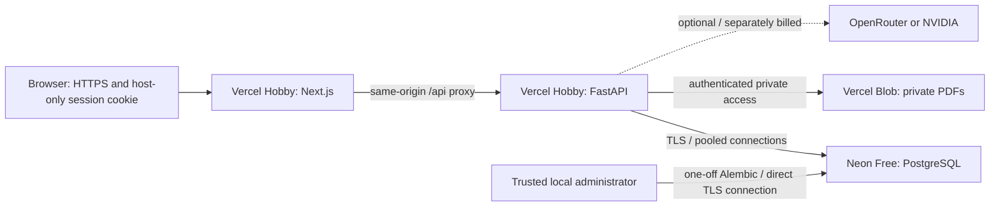

# ProfitLens: free college-demo deployment

Decision recorded 15 October 2026. This is a non-commercial faculty demo, not a paid SaaS launch. The frontend and API are now deployed on Vercel Hobby with Neon Free and private Blob storage. See the live verification record below for the checks actually completed.

## Architecture decision

Use two Vercel Hobby projects from this repository: Next.js (`apps/web`) and FastAPI (`apps/api`). Keep PostgreSQL on Neon Free and PDFs in a **private** Vercel Blob store attached only to the API project. Browser requests go through the frontend's `/api` rewrite; all authorization remains in FastAPI. Use a fresh cloud demo database, not the local working database.



Two projects preserve the existing framework roots and avoid mixing Next.js routing/build output with a Python catch-all. A single mixed deployment could work with additional routing/build conventions, but is not selected. Render Free is an alternative API host, but its filesystem is also ephemeral and it sleeps after inactivity; it still needs external PDF storage. Paid persistent-container hosting preserves the original disk design but fails the zero-cost goal. See [Render's free-service restrictions](https://render.com/docs/free).

The older deployment note saying FastAPI necessarily needs persistent hosting is superseded: [Vercel supports FastAPI as one Python function](https://vercel.com/docs/frameworks/backend/fastapi). The database and documents still require persistent services. This project uses lightweight lexical BM25, not local neural models or pgvector.

## Free-tier constraints

- [Vercel Hobby](https://vercel.com/docs/plans/hobby) is for personal, non-commercial use. A college demonstration fits that intended use; a commercial service needs a suitable plan. Free quotas can suspend service. Use the supplied `vercel.app` domains to avoid domain purchase costs.
- [Function limits](https://vercel.com/docs/functions/limitations): 4.5 MB request/response payload, 500 MB uncompressed Python bundle, 2 GB Hobby memory and up to 300 seconds with Fluid Compute. This configuration uses a shorter 90-second API duration. The app's hosted upload cap will be 4,000,000 bytes, leaving multipart overhead. Oversized legacy PDFs require local/container delivery, not a promise of large-file hosting.
- [External rewrite limit](https://vercel.com/docs/limits): 120 seconds. AI per-call timeout is limited to 20 seconds in this deployment; planning and answer generation may make two calls. Cold starts and database wake-up add latency.
- [Blob allowances](https://vercel.com/docs/vercel-blob/usage-and-pricing): 1 GB stored, 10 GB transfer, 10,000 simple and 2,000 advanced operations included monthly on Hobby. Private/public pricing is the same; exhaustion can block access. [Private Blob storage](https://vercel.com/docs/vercel-blob/private-storage) is available on all plans and requires authenticated delivery.
- [Neon Free](https://neon.com/pricing), checked on the date above: 100 CU-hours per project/month, 1 GB storage per project, idle scale-to-zero. Its free restore window is limited; keep your own verified backups. Account/dashboard terms at signup are authoritative if allowances change.
- No platform allowance makes OpenRouter/NVIDIA inference free. Leave `AI_PROVIDER` disabled for a zero-provider-cost demo; financial calculations, imports, retrieval and extractive investigations remain usable. Actual AI chat requires a separately configured provider/model and its billing/quota.

## Audit and implementation record

Baseline: `669d988bd686ce739b6558c06c97f6fc9035117f`. Tracked tree was clean. Untracked presentation files and the private notes/secrets are preserved. Actual code includes authenticated organizations/customer grants, CSV preview/confirm, Decimal finance, reviewed PDF terms, BM25 retrieval, structured investigations and scoped AI chat. SaaS expansion in archived research is not implemented and is not needed for hosting.

Deployment gaps found: disk-backed PDF writes, no cloud entrypoint, default local API rewrite, default local database pool, insecure-cookie development defaults, and upload sizes above function payload limits. Existing API responses already use `no-store`, origin checks and server-side sessions. No migration or seed runs automatically during API import. Cloud credentials, account settings, Linux provider build and live HTTPS smoke checks remain external verification steps.

Implementation, exact setup, validation results and rollback instructions are recorded below as work is completed.

## Files and runtime changes

| Location | Purpose |
|---|---|
| `apps/api/index.py`, `vercel.json`, `.python-version`, `requirements.txt` | FastAPI entrypoint, 90-second function, Python 3.12, runtime-only pins synchronized with the main lock |
| `apps/web/vercel.json`, `next.config.ts` | Next.js build and HTTPS API-origin validation on Vercel |
| `apps/api/profitlens/config.py`, `database.py` | Fail-fast hosted settings; NullPool and disabled automatic prepared statements for the external transaction pool |
| `apps/api/profitlens/storage.py`, `main.py` | Opt-in private Blob adapter, temporary PDF parsing, authorized download with SHA-256 verification and bounded response; existing local layout retained |
| `apps/web/app/page.tsx` | Fetch upload limits from `/api/config`; reject large files before sending them |
| Environment examples, `.vercelignore`, `.gitignore` | Separate frontend/backend settings; exclude local secrets/build artifacts |
| `tests/test_deployment.py`, `tests/test_workspace.py` | Unsafe configuration, real SDK with mocked HTTP, file integrity, limits, secure cookies, authorization and storage-failure checks |

No schema or business-record migration is introduced. No existing documents are copied to the cloud. Blob calls always use private access; browser responses do not expose its token or delivery URL. The cloud SDK dependency is pinned; its transport is separate from the existing AI client's `httpx`. Local documents keep the same organization/generated-key layout.

## Environment names and placement

Never put secrets in Git, chat, screenshots, browser code or `NEXT_PUBLIC_*`. Vercel system variable `VERCEL` enables additional serverless checks automatically. Assign backend values to **Production only** initially.

| Project | Name | Configuration |
|---|---|---|
| Frontend | `API_INTERNAL_URL` | Stable HTTPS API project origin, without `/api` or trailing path; build-time setting |
| API | `APP_ENV` | production |
| API | `DATABASE_URL` | Neon **pooled** TLS connection; use the `postgresql+psycopg` driver prefix and retain SSL parameters |
| API | `DATABASE_POOL_MODE` | null (Neon performs pooling; no per-instance QueuePool) |
| API | `WEB_ORIGIN` | Exact stable frontend HTTPS origin, no trailing slash/path; do not list arbitrary preview domains |
| API | `COOKIE_SECURE` | true |
| API | `SESSION_HOURS` | 8 |
| API | `STORAGE_BACKEND` | vercel_blob |
| API | `BLOB_READ_WRITE_TOKEN`, `BLOB_STORE_ID` | Private store credentials/ID from Vercel Storage; API only |
| API | `UPLOAD_LIMIT_BYTES` | 4000000 |
| API | `AI_TIMEOUT_SECONDS` | 20 |
| API | `AI_PROVIDER` | disabled for no inference charges; otherwise the existing supported provider |
| API, only if enabled | `AI_MODEL`, `OPENROUTER_API_KEY` or `NVIDIA_API_KEY` | Explicit model and matching server-only key; set provider spending limits separately |
| Local only | `STORAGE_DIR`, `POSTGRES_PASSWORD`, `DEMO_PASSWORD`, `NEXT_DIST_DIR` | Development/provisioning settings; do not copy these blindly into Vercel |

`DATABASE_URL` contains credentials. The application accepts Neon-managed `postgresql://` and `postgres://` URLs and selects `postgresql+psycopg` internally, preserving encoded credentials and query parameters. TLS remains mandatory in production. An explicit `postgresql+psycopg://` URL also works. Do not paste a live URL into a terminal command that will be logged.

## Setup: database and storage

1. Create a **Free** Neon project and an empty PostgreSQL database for the faculty demo. Select a region near the Vercel API region. Record both pooled and direct connection details privately. Use the pooled URL for runtime and the direct URL for one-off migrations. [Neon pooling documentation](https://neon.com/docs/connect/connection-pooling) explains transaction pooling; application-level NullPool avoids accumulating idle connections across functions.
2. Use one database owner credential only for trusted local migration/provisioning. A dedicated least-privilege runtime role is recommended before using any sensitive data. The application already enforces organization/customer access, but does not use PostgreSQL RLS as an independent security layer.
3. In the Vercel API project, open **Storage → Create Database → Blob**, select **Private**, and connect it to that project for Production. Confirm the account is on Hobby and the store is private. Record the read-write token and store ID in the API environment settings. Do not attach that store to the frontend or share it with previews.
4. Do not migrate the local working database or local PDFs just to make the demo work. Provision a fresh synthetic demo explicitly using the commands below. Changing `STORAGE_BACKEND` does not migrate old files; a database restored without its matching private files is incomplete.

## One-off migrations and demo provisioning

From `D:\Profitlens`, create a private `.env.cloud-admin` file based on `apps/api/.env.example`. Fill it locally with the **direct** database URL and private store settings, the intended frontend HTTPS origin, and production settings. The file is Git-ignored. Do not change the normal `.env`. Ensure this file targets the new cloud demo database before running any command.

```powershell
.venv\Scripts\python.exe -m pip install -r requirements.lock
.venv\Scripts\python.exe -m pip install --no-deps -e .
.venv\Scripts\python.exe -m dotenv -f .env.cloud-admin run -- .venv\Scripts\python.exe -m alembic current
.venv\Scripts\python.exe -m dotenv -f .env.cloud-admin run -- .venv\Scripts\python.exe -m alembic upgrade head
.venv\Scripts\python.exe -m dotenv -f .env.cloud-admin run -- .venv\Scripts\python.exe -m alembic check
```

Expected migration head: `20261015_roadmap`. Run this **once**, before the deployment serves traffic. No migration runs in a function request or Vercel build. For an existing database, back up and test restoration first; do not run the destructive pytest fixtures against it.

For an **empty synthetic demo only**, optionally run:

```powershell
.venv\Scripts\python.exe -m dotenv -f .env.cloud-admin run -- .venv\Scripts\python.exe -m profitlens.manage seed-demo
```

This explicitly uploads generated synthetic contracts to the selected private store and creates synthetic organizations/accounts. It prompts for a password of at least 12 characters; existing accounts/passwords are not overwritten. The demo's admin/finance/analyst accounts share that chosen demonstration password, so use only synthetic content and restrict distribution. Sign in as `karan@profitlens.local`. Do not publish passwords in README. Use `add-user --help` for separate accounts in an existing organization. There is no public signup/password-reset flow.

## Exact Vercel Git/dashboard steps

1. Commit the reviewed readiness files and push them to the personal repository `karankirtisharma/Profitlens`. Preserve presentation artifacts/private notes; do not force-add ignored files. This preparation does not itself create a deployment.
2. In Vercel's personal Hobby account, choose **Add New → Project → Import Git Repository**, select Profitlens. Name the backend project, set **Root Directory `apps/api`**, framework **FastAPI**, Python **3.12** (repository `.python-version`), and keep the detected dependency installation from `requirements.txt`. Leave build/output overrides unset; `vercel.json` supplies the function duration. No Docker/start command is needed.
3. Set the API Production variables above. Reserve/choose the frontend project name so `WEB_ORIGIN` can use its intended stable production domain. Create/connect the private store and verify credentials before the successful API deployment. A first build without complete settings may fail safely; add settings and redeploy. Keep Fluid Compute enabled. Choose an API function region near Neon in Project Settings. Deploy, then check `/api/live` and `/api/health`.
4. Import the **same Git repository again**, name the frontend project, set **Root Directory `apps/web`**, framework **Next.js**, Node **24.x** to match CI, install **`npm ci`**, build **`npm run build`**, default Next.js output directory. Add only `API_INTERNAL_URL` with the backend's stable HTTPS production origin. Deploy.
5. Confirm the assigned frontend domain exactly matches backend `WEB_ORIGIN`. Update/redeploy the backend if Vercel assigned a different name. Changing `API_INTERNAL_URL` needs a **frontend rebuild**, not just a browser refresh.
6. The API's **production** URL must be reachable by the frontend proxy. If Vercel Deployment Protection challenges that URL, use the project's protection settings to allow the production API while retaining preview protection; existing ProfitLens login/permissions remain mandatory. Do not send a bypass token to browser code. Confirm available controls on your Hobby account. If production cannot be made reachable, this topology is blocked until protection/routing is resolved.
7. Do not assign production database, Blob or AI secrets to Preview/Development environments. Do not connect PR previews to the production API. Leave previews unconfigured (their fail-fast checks may fail) or provision a separate test API, database and store with its own exact frontend origin. No wildcard CORS/Origin exception is needed.
8. Subsequent Git pushes trigger each linked project. Review both deployment statuses: frontend and backend are separate releases, not an atomic pair. Preserve compatible API contracts across releases.

Browser auth stays on the frontend domain: `/api/auth/login` is rewritten to FastAPI, which returns a host-only, Secure, HttpOnly, SameSite=Strict cookie. The browser never needs a cross-domain session or permissive CORS. Direct API mutation requests without the exact trusted Origin are rejected; Origin is a CSRF safeguard, not a substitute for authentication. Vercel must preserve the request Origin and response Set-Cookie through its external rewrite—verify the live smoke tests below.

## Post-deployment smoke tests (requires real deployment)

- GET API `/api/live` → 200 without DB access; GET `/api/health` → 200 after PostgreSQL connectivity; frontend `/api/health` must also return JSON, not a login/protection page. Health does not prove schema/storage readiness.
- Login from the frontend; inspect cookie flags without copying its value. Reload, switch permitted workspaces, log out, and verify expired/removed sessions return 401. An untrusted Origin must fail.
- Preview then confirm a small synthetic CSV; retry confirmation and verify no duplicate records. Upload >4 MB via UI: rejection before transmission. Platform/direct oversized requests may return Vercel's own 413 error.
- Upload a small text PDF, inspect pages and download it through ProfitLens. Download bytes must match their original hash. No anonymous or other-organization request may obtain the document. Accessing a private Blob delivery URL without credentials must fail.
- Redeploy the API, then reopen the same PDF and records. This proves persistence beyond function/local-disk lifetime. Failure here blocks readiness.
- Verify known synthetic contribution/margin and a missing-cost case; source links and permission-restricted analyst views must still work.
- With AI disabled, financial functions work and chat reports provider unavailable. Only if separately funded/enabled, test one synthetic grounded question, citation and provider-failure state; never promise inference is free.
- Check Vercel/Neon storage/compute/transfer usage after the demo. Check error logs without logging request bodies, cookies, keys or document content. Test cold-start login after inactivity before the panel.

## Rollback and operational limitations

There are **no new database migrations** in this readiness change. For a faulty release, redeploy the previous known-good compatible frontend/API revision through Vercel's deployment/Git controls and restore that revision's environment settings. Keep a record of both deployment IDs. Do not downgrade Alembic or delete cloud data as a routine code rollback.

An older API without the Blob adapter **cannot read cloud PDFs**. Roll back to a Blob-compatible revision, or pause the hosted demo and use the preserved local installation. Never switch a cloud API to local storage to hide a failed Blob integration. Keep the private store and DB together; do not revoke/delete them until their data is backed up and the replacement verified.

Before future schema changes, use `pg_dump` with privately supplied credentials and back up all referenced private objects; verify restoration into an isolated database/store. A database dump alone excludes PDF bytes. No automatic backup/migration job has been configured. Blob writes and PostgreSQL commits are not a distributed transaction: upload failure prevents a new DB record, and ordinary insert failures trigger cleanup; a process crash/ambiguous remote response/commit failure can leave an orphan private object. Do not automatically delete such objects; reconcile keys and hashes during maintenance.

Free hosting is best suited to a small synthetic college demo. Cold starts, quota exhaustion, lexical retrieval limits, bounded synchronous parsing, no OCR, no MFA/password recovery, no persistent background jobs and external provider outages remain limitations. This is deployment preparation, not a production-security certification or an availability guarantee. A private Blob store still contains sensitive data accessible to its account administrators; use synthetic fixtures for the public demo.

## Validation record — 15 October 2026

| Check performed | Actual result |
|---|---|
| Full pytest suite, dedicated `profitlens_test` | **139 passed in 13.12 seconds**; includes SDK mock transport, secure session, upload cap, file integrity and existing financial/access regressions |
| Full Chromium acceptance suite, isolated 3002/8002 and `profitlens_e2e_test` | **15 passed in 1.7 minutes** |
| Added browser oversized-upload check | **1 passed in 13.6 seconds**; no preview-upload request was sent |
| Next.js production build with Vercel mode and a placeholder HTTPS backend origin | Passed; no cloud deployment or API call made |
| TypeScript, ESLint and frontend formatting | Passed |
| Python Ruff lint/format | Passed, 48 files checked |
| `pip check`; production `npm audit` | No broken requirements; **0 npm production vulnerabilities reported**. This is not a full Python dependency security audit. |
| API-root import under hosted configuration | Passed; liveness/config work without database calls, NullPool selected |
| Actual NullPool/psycopg connection and `alembic check` on test DB | Passed; no new upgrade operations detected |
| Runtime dependency resolution/download for Linux Python 3.12 | 40 wheels resolved, approximately 53.6 MiB uncompressed dependency content; **not** a measured Vercel function bundle |
| Deployment config checks | JSON/offline tests passed; selected settings validated against current official Vercel property constraints |
| Git whitespace check | Passed |
| Live Neon, Blob, HTTPS session/rewrite, Vercel build/cold-start/quota checks | **Not run**: account resources, deployment credentials and deployed URLs are not configured |

The initial SDK test mock replaced a class with a function and was corrected to retain the SDK's type checks. One new authorization test expected 403 where the existing application intentionally returns 404 to hide an inaccessible workspace; corrected without relaxing authorization. Final full backend run passed. The first wheel probe used an older Linux platform tag; checking the published newer compatible tags resolved the Argon2 wheel. Full upstream JSON Schema validation could not run unchanged because the fetched schema declares Draft 4 but contains newer-draft keywords in unused experimental properties; only the settings this repository uses were validated. Vercel's actual build remains the final configuration authority.

Primary source links above were checked on this date. Python integration follows the official [Blob Python SDK](https://vercel.com/docs/vercel-blob/python-sdk-reference); dependency packaging was checked against the [Vercel build environment](https://vercel.com/docs/builds/build-image) and [Python runtime](https://vercel.com/docs/functions/runtimes/python). No real files or AI prompts were sent to cloud services during verification.

## Deployment checklist

- [x] Inspect Git/manual changes, current source, migrations, environment examples, active minor-project SRS/architecture and historical deployment notes.
- [x] Preserve the working application and local data; add opt-in cloud storage and small deployment safeguards.
- [x] Verify local backend, browser, build, static and dependency checks; document their limits.
- [x] Review/commit/push the readiness files; publish the managed-URL compatibility fix.
- [x] Confirm Vercel Hobby and Neon Free in the dashboards; no paid resource or trial selected. Intended use is a non-commercial college demo.
- [x] Create the empty cloud database and **private** Blob store; configure secrets only in backend Production.
- [x] Run direct-connection Alembic upgrade/check once; explicitly provision fresh synthetic demo data.
- [x] Deploy API and frontend; verify stable domains, exact Origin and unauthenticated health access without changing platform protection settings.
- [x] Pass login/logout, tenant isolation, import, PDF persistence across redeploy, finance and provider-disabled smoke checks.
- [ ] Record deployment IDs, inspect usage, verify private backups and rehearse the local fallback before the review.

## Live deployment record — 15 October 2026

This section supersedes the earlier pre-deployment verification status above. No existing local business data or local real-data workspaces were copied. Only repository synthetic fixtures and an explicitly labelled synthetic cloud QA case were provisioned.

| Component | Actual configuration |
|---|---|
| Frontend | [profitlens-six-psi.vercel.app](https://profitlens-six-psi.vercel.app), Vercel project `profitlens`, root `apps/web`, Next.js, Hobby |
| API | `https://api-pink-nu-35.vercel.app`, project `api`, root `apps/api`, FastAPI, Hobby |
| PostgreSQL | Neon `profitlens-demo-db`, Free plan, Washington DC region; Auth and Realtime disabled |
| PDFs | `profitlens-private-pdfs`, **Private**, IAD1; API Production connection only |
| Authentication | Same-origin frontend rewrite verified; Secure, HttpOnly, SameSite=Strict, host-only session cookie |
| AI | Initially disabled; enabled later the same day with OpenRouter `openai/gpt-4.1-mini`. See the follow-up verification below. |
| Schema | Empty database verified before migration; head `20261015_roadmap`; `alembic check` reported no new upgrade operations |
| Demo inventory | Northstar Services: 11 customers, 58 invoices, 85 expenses, 3 PDFs; separate Seabrook fixture supports isolation checks |

The native Neon integration supplies `postgresql://` URLs. Commit `32d3d0cc380d43392b646ebc4ffd77f723e21ef7` adds driver-prefix normalization without modifying credentials, encoded characters or TLS parameters. The integration-managed value remains intact. Focused deployment tests: **18 passed**, Ruff lint/format passed. [GitHub Application checks passed](https://github.com/karankirtisharma/Profitlens/actions/runs/38780119105).

Verified code-release deployment IDs (later documentation-only pushes can produce newer IDs): frontend `8GGEfDMk4JxyiQRmzoQTbYvCKHwP`; API initial configured release `3jKFAiBBQR92X2S2YEJ2JVEPNhW5`; deliberate API redeploy for persistence verification `BgJxGc96GVMFr3JVDvPB6mQwXdXF`. Both projects reported Ready. The user's first API deployment predated environment configuration and failed requests; the configured release supersedes it. Historical dashboard error percentages include those earlier failures.

### Actual hosted verification

- **53 live smoke assertions passed** using HTTPS through the frontend: public health/config, unauthenticated denial, login/logout, cookie flags, hostile Origin rejection, cross-organization denial, seeded records, private PDF hashes, CSV preview/confirm and repeated confirmation, deterministic finance, missing-cost handling, lexical retrieval endpoint, disabled-provider status, analyst grants and denied analyst writes.
- A separately generated PDF was uploaded through the hosted API, remained unreviewed, deduplicated on repeat upload and downloaded with matching SHA-256. After redeploying the API, the same PDF still downloaded with the same hash. Logout/anonymous access was denied before and after redeployment.
- Browser checks verified login, populated dashboard/charts, contract page evidence/review dialog and the financial analysis view. `CLOUD-QA`, October 2026, has revenue INR 9,500.00, reviewed cost INR 7,000.00, contribution INR 2,500.00 and margin 26.32%. These are synthetic ground-truth values, not measured customer outcomes.
- `/api/live`, `/api/health` and `/api/config` returned 200 on both the direct API domain and frontend proxy. Hosted file limits were 4,000,000 bytes.

This is a bounded deployment smoke test, not a complete hosted load/security audit. Full local regression evidence remains in the earlier table. Extended idle/cold-start behaviour, quota exhaustion, disaster recovery and direct anonymous Blob-delivery access were not tested in this cloud setup. The initial checks ran with AI disabled; the follow-up below records bounded live AI checks. Storage is configured Private and API anonymous/cross-organization access was tested. A dedicated least-privilege database runtime role and verified backups remain recommended before sensitive use. Do not run destructive pytest fixtures against this demo database.

### Using and maintaining this deployment

1. Open the frontend URL above. Authorized local administrator login details are stored in the Git-ignored `.local/cloud-demo-login.txt`; passwords are not published in the repository. There is no public signup.
2. Choose Northstar Services. Overview shows synthetic activity; use `CLOUD-QA` and month `2026-10` in Profitability & evidence for the verified arithmetic example. Inspect `contract_C001.pdf` for reviewed source evidence. New CSV/PDF uploads still require the application's normal preview/review flow.
3. Future code updates: run relevant checks, commit and push `main`, then check **both** Vercel project deployments. Never assume one Ready badge proves the other project or all user flows work.
4. Production environment changes need a redeploy. `API_INTERNAL_URL` also requires a frontend rebuild. Do not attach production resources to Preview. The Blob creation wizard initially selected Preview too; it was explicitly removed before any configured deployment.
5. The private `.env.cloud-admin` holds the direct TLS database URL and private store settings for one-off local administration. It is separate from the ordinary local `.env`. Do not commit, display or paste its contents into support logs. Synthetic provisioning and migrations are explicit, never build hooks.
6. Keep the Free/Hobby plans and monitor their shared quotas. Vercel's account dashboard already showed approximately 8.87/10 GB deployment storage across existing projects during setup; this is an account-wide observation, not ProfitLens usage. No unrelated projects were deleted and no paid upgrade was selected.
7. Before the faculty review, rehearse after an idle period, keep a working local fallback, and test a private database-plus-PDF backup/restore. The earlier rollback section applies; use a Blob-compatible API revision.

### Hosted AI follow-up — 15 October 2026

With explicit authorization, the existing local OpenRouter credential was saved as `OPENROUTER_API_KEY`, type **Secret**, in the **API project / Production only**. It was not added to the frontend, Preview, Development, Git or public documentation. `AI_PROVIDER=openrouter` and `AI_MODEL=openai/gpt-4.1-mini` retain the local model. `AI_TIMEOUT_SECONDS=20` remains unchanged. API deployment `FT8dosFLAWkQUmcgUqZVh3CLiXuJ` reported Ready on source revision `fb55a01`; this was a configuration deployment without application-code changes.

**24 assertions passed across four live synthetic chat scenarios**, through the frontend's HTTPS `/api` proxy and normal session authentication:

| Check | Observed result |
|---|---|
| Manual customer/month financial question | Exact synthetic CLOUD-QA values: revenue 9,500, cost 7,000, contribution 2,500 INR; margin 26.32% |
| Automatic workspace question | Selected October 2026 and all accessible customers; returned financial summary and navigation actions |
| Reviewed contract question | Returned the 10,000 INR monthly fee with a reviewed, page-linked source |
| Unsupported future net-profit question | Marked insufficient evidence; did not produce a guaranteed forecast |
| Authentication and permissions | Anonymous chat denied (401); cross-organization request and analyst request for an unassigned customer denied (404) |
| Provider metadata | Correct provider/model configured; status response contains no credential field |
| Browser popup | Additional automatic customer/month question returned a live answer, financial cards, record navigation and a source excerpt in the popup |

Local reproducible checks and redacted synthetic results are retained under Git-ignored `.local/cloud_ai_smoke.py` and `.local/cloud-ai-results.json`. They require the separately provisioned demo login; they do not read or send local business files. Re-running calls the live provider and consumes credits. The provider's `live_model_verified` status field remains false by design because configuration alone is not a test result; the observations here establish the bounded test evidence.

Limitations: this is not an accuracy benchmark or a guarantee for arbitrary questions. Numeric/source checks do not validate all prose. Observed replies included awkward count wording and a duplicated percentage suffix in one browser answer; the financial cards remained correct. One insufficient-evidence reply suggested supplying future data, which should not be interpreted as making a forecast or guarantee possible. No timeout/outage simulation or spending-limit exhaustion was performed on production. Only synthetic cloud evidence was used.

Hosting stays on Hobby/Free plans. OpenRouter inference is separately metered. The existing answer limit is 900 output tokens, automatic scope planning is 350, and chat is limited to 20 requests per minute per workspace. Disable inference by setting API Production `AI_PROVIDER=disabled` and redeploying; financial records, imports and deterministic reporting continue to work. Do not copy the key to any `NEXT_PUBLIC_*` variable.
