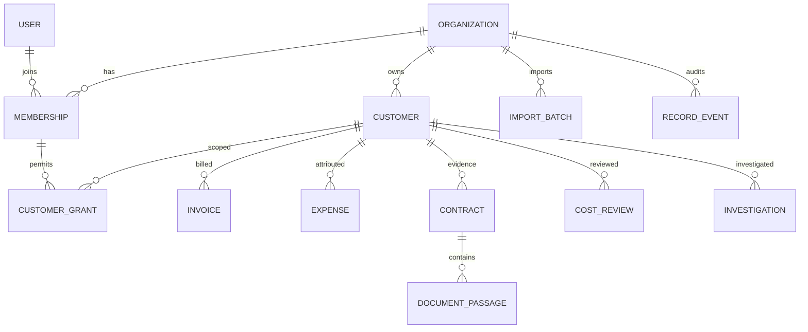

# ProfitLens — bounded minor-project data model

15 October 2026 · active scope v0.2. Preserve the current typed model and its financial meaning. The wider entity catalogue is [archived future research](../research/archive/expanded-design-2026-10-15/architecture/canonical-data-model.md), not a required migration.

## 1. Entities retained

| Entity | Purpose / existing fields | Relationship and rule |
|---|---|---|
| organizations | ID, name, currency | Owns tenant business records; one supported currency per workspace |
| users, memberships, sessions | Identity, role and login session | Existing admin/finance/analyst roles; no custom role builder |
| customer_grants | Membership/customer IDs | Restricts analyst visibility; no grant means no customer access |
| customers | customer_id, name, industry, source | Organization-scoped; industry may be blank |
| invoices | invoice_id, customer_id, billing_period, currency, subtotal, discount, tax, refund, total, source | One aggregate record per supplied invoice; existing equation enforced; no invoice-line redesign |
| expenses | expense_id, customer_id, billing_period, currency, category, amount, source | Supplied attributed costs only; no inferred vendor/customer match or allocation |
| import_batches | File fingerprint, kind, normalized rows, issues, state, result, actor | Preview then atomic confirmation; duplicate-safe retry |
| contracts | Customer, private PDF identity/pages, reviewed monthly rate/discount/currency/dates/page | Optional evidence; reviewed terms only valid for their applicable period |
| record_events | Actor, action, record, snapshot, time | Corrections retain audit/source evidence |
| cost_reviews | Customer/month, expense-input hash, reviewer, note | Changes invalidate completeness attestation |
| document_passages | Contract, customer, page, content, index version/hash | Authorized BM25 evidence; unused embedding column does not mean vector search exists |
| investigations | Customer/month/question, evidence/result snapshot, actor/time | Reauthorized history; stale evidence is disclosed |

No new vendors/payments/projects/inventory/timesheets/credit-ledger/contract-version tables are required for this project. Existing entities remain separate; do not flatten records into a universal table.

## 2. Field requirement policies

R = required for the supported operation; O = optional; C = conditional; S = system-assigned; U = unknown source field.

| Fields | Policy | Why |
|---|---|---|
| Organization ownership | S | Authenticated scope, never an import-supplied trust decision |
| Customer ID/name | R | Persisting and referencing a customer |
| Industry | O value | Current CSV still expects the industry header but allows an empty value |
| Invoice/expense ID | R | Stable org-scoped identity and duplicate protection |
| Customer ID/month/currency | R for current financial record | Needed for customer-period calculation under current schema |
| Invoice subtotal/discount/tax/refund/total | R | Existing formula needs all components; unknown tax is not zero |
| Expense amount/category | R in current template | Amount meaning and traceable classification; no guessed allocation |
| Invoice contract reference | O / absent in current invoice schema | A valid invoice need not have a contract |
| Contract currency/effective dates/rate/discount/source page | C | Required to mark terms reviewed and use them for price comparison |
| Source row/page/hash and audit timestamps | S | Traceability, not manually invented financial values |
| Unknown extra columns | U | Current strict parser rejects them visibly; optional mapper must retain rather than discard them |

No configurable form/field-policy engine is required. A small shared field definition or documented template is enough. Supported templates must state semantics and field policies clearly.

## 3. Current relationship diagram

All business links remain tenant-scoped. Contract applicability is checked by customer/currency/reviewed period; the current model does not have an explicit invoice-contract allocation table. That limit must be stated rather than drawing nonexistent links.

## 4. Exact supported calculations

Net billed revenue = sum(subtotal - discount - refund), excluding invoice tax. Recorded attributed cost = sum(valid supplied expense amounts). Contribution = revenue - cost; margin = contribution / revenue × 100 when revenue is positive and inputs exist.

Missing cost is unknown, not zero. Recorded but unattested costs permit a clearly provisional result; attested coverage does not establish audited net profit. Zero revenue makes margin unavailable. Cost updates invalidate the cost review. Pricing uses pre-refund billed charges compared with one reviewed fixed full-month rate minus monthly discount; ambiguous/partial periods block that comparison.

A missing contract cannot produce a verified expected amount. The legacy refund field is not evidence that cash was returned; later accounting-ledger work would need separate semantics.

## 5. Bounded flexibility and honest exclusions

Core supports documented CSV schemas and readable contract PDFs. If time permits, add reviewed aliases for two known export layouts while retaining original values, unknown fields and exact customer-ID matching. Do not add AI auto-linking or arbitrary user-authored validation code.

Generic council spending has no customer allocation: retain its source information in a separate component demo, never claim customer profit. Existing explicitly labelled technical buckets are ingestion workarounds, not real customer relationships. Keep signed credits, multi-currency records, unknown tax bases, payments and invoice-line exports outside supported calculations until a separately reviewed adapter exists. Reject clearly rather than manufacture missing fields.

Any future change must be additive and tested against old fixture totals, IDs, sources and grants. No schema migration is authorized by this documentation update.
