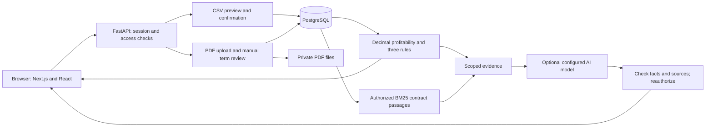
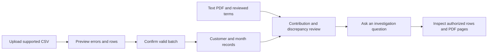

# ProfitLens — minor-project architecture

15 October 2026 · active scope v0.2. **Keep the existing modular application.** The expanded platform architecture is future reference only; no new implementation is performed in this revision.

## 1. System architecture

This reflects existing components. The API computes financial facts; the model explains supplied evidence. Private documents and source links require authorization independently of the answer. No pgvector, microservice platform or model training is assumed.

## 2. Demonstration flow

If a required input is missing, display what is unavailable and why. The workflow does not need every organization to supply a contract: revenue reporting is separate from contract-price comparison.

## 3. Service boundaries to retain

| Boundary | Existing component | Completion focus |
|---|---|---|
| Identity/access | security.py, main.py | Preserve tenant/customer scope and role checks |
| Import/data | ingestion/, imports.py, records.py | Keep strict meaning, atomic confirm and duplicate safety |
| Private evidence | contract routes, pypdf, private files | Review monthly terms; do not add general OCR |
| Calculation | finance.py, profitability.py | Verify amounts, completeness, three explicit rule categories |
| Retrieval | retrieval.py | BM25/context baseline and page sources; report lexical misses |
| AI | explanations.py, chat.py, assistant.py, analysis_api.py | Clear evidence prerequisites, checked facts, insufficient-evidence states |
| UI | Existing workspace/finance/analysis/chat components | Working controls and source inspection; no redesign required |
| Delivery | Existing launcher, migrations and tests | Repeatable local demo and accurate documentation |

Use current API routes and database design. A shared evidence helper may be extracted if a specific inconsistency requires it, but a broad rewrite is not a milestone.

## 4. Small improvements allowed within scope

First address a demonstrated core defect or misleading state. For example, a question about available revenue should not require a contract; a claim about an agreed price must require applicable reviewed terms. Verify both paths.

Only after core checks: supervised CSV aliases for two documented layouts, or XLSX with identical semantics. Each option needs explicit original-value/unknown-field handling and preview confirmation. None requires a general organization-configuration subsystem.

## 5. Security and reliability at minor-project scale

Keep server-side credentials, existing session/origin guards, private files, tenant-scoped queries and reauthorization after model calls. Imported documents are untrusted data, not executable instructions. AI must not mutate records or choose broader permissions.

Keep upload/page/row/query limits and meaningful failure states. Check failed/repeated imports, provider outages and missing source files. Any public deployment needs separate HTTPS/storage/secrets/recovery verification; local faculty demonstration is the completion target, not production certification.

## 6. Why this is sufficiently technical

The engineering depth is in correct arithmetic, database constraints, transactional imports, temporal contract evidence, access isolation, context-aware retrieval, checked model output and reproducible comparisons. Additional accounting modules would broaden the problem without strengthening this focused demonstration.

See [SRS](../requirements/SRS.md), [data model](canonical-data-model.md), [roadmap](../implementation/phased-roadmap.md) and [testing](../testing/test-strategy.md). The prior [architecture](../research/archive/expanded-design-2026-10-15/architecture/target-architecture.md) is explicitly outside the required build.
