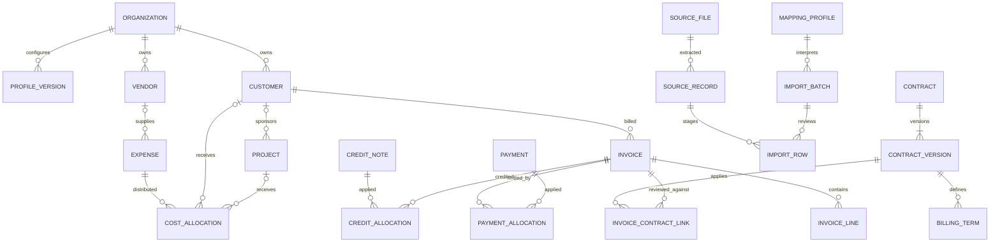

> **Archived expanded proposal — superseded for COM-711.** This is future research, not the current implementation backlog. Use the [active minor-project SRS](../../../../requirements/SRS.md). Historical claims below retain their original audit context.

# Proposed canonical data model

Version 0.1 · 15 October 2026 · **design for review, not deployed schema**. [Current schema/gaps](gap-analysis.md), [requirements](../requirements/SRS.md), [migration sequence](../implementation/phased-roadmap.md).

## 1. Design decisions

Use typed relational entities and constrained relationships for financial meaning. Use validated JSONB only for configuration, raw source payloads, typed custom-field values and diagnostic metadata. Do not replace invoices, payments, expenses and contracts with one generic financial table. Share value types, validation services and provenance conventions across their tables.

Every tenant-owned table has `(organization_id, id)` identity and composite foreign keys. Source IDs are separate strings, including leading zeros; namespace uniqueness is `(organization_id, source_system, entity_type, external_id)`. Existing legacy IDs remain valid through a crosswalk and old endpoints. System UUIDs do not imply an original business identifier exists.

### Field policy legend and common fields

R = required for the named operation; O = optional; C = conditional; S = system-generated; U = source field not mapped. Persisted normalized records may be incomplete for one workflow while usable in another. Raw staging accepts missing business fields but is never included in financial totals.

| Common field / type | Policy | Rule |
|---|---|---|
| organization_id UUID/string compatible with existing org key | S | Derived from authenticated scope; caller cannot change ownership |
| id UUID, created_at UTC timestamp, created_by user ID, revision integer | S | Assigned on creation; optimistic concurrency on updates |
| external_id text, source_system text | O / C | Both required when matching by external identity; generated source-row IDs explicitly labelled derived |
| source_record_id / manual_event_id | C | At least one required for every persisted financial assertion; source row/page must resolve |
| lifecycle_state enum | S / C | Controlled by transitions; input source status preserved separately |
| custom_values JSONB | O | Only registered typed fields; schema/version attached; unknown columns go to staging, not arbitrary custom values |
| archived_at UTC timestamp | O | Logical archive cannot erase referenced history |

Monetary quantities use Decimal serialized as strings. Proposed storage `NUMERIC(24,8)` for exact imported amounts, rates `NUMERIC(24,10)`, quantities `NUMERIC(24,8)`; explicit supported-currency scale and rounding on calculations/display. Reject precision overflow; never round silently on import. Retain source precision and original strings. Currency is validated against a versioned supported-code set; a three-letter regex alone is insufficient. Initial calculations remain same-currency; unsupported FX aggregates are unavailable.

## 2. Organization and identity dictionary

Each row below lists fields beyond the common envelope; grouped fields share the stated policy. This is the supported v0.1 design field inventory, not an open-ended promise to ingest any business semantics. New supported fields require dictionary/policy/test changes.

| Entity | Fields, types and policies | Ownership / lifecycle |
|---|---|---|
| Organization | name text R; reporting_currency code R; active_profile_version integer S | Preserve current ID and currency; reporting currency changes cannot reinterpret historical values |
| OrganizationProfile | version integer S; schema_version integer S; preset_key text R; enabled_modules set R; locale/date_formats/timezone R; supported_currencies set R; tax_basis policy R (may explicitly be unknown); period_policy R; field_policies/forms/categories/allocation_rules/report_preferences/validation_policies/provider_policy typed JSON R with safe defaults; effective_at timestamp R; change_reason text R; prior_version integer S | Immutable version, draft→validated→active→superseded; admin only; no executable SQL/Python/JS settings |
| User / Membership / CustomerGrant | Existing user identity/password/session fields preserved; membership role R, permitted customer IDs O (empty means no customers for analyst) | Employee identity separate from login. Preserve preset roles; configurable role catalogue deferred |
| Customer | name text R; industry text O; external aliases O; contact_id O | Invoice reporting owner; do not use a technical bucket as a real customer |
| Vendor | name text R; external aliases O; contact_id O; tax_identifier text O (sensitive) | Own supplier identity. Explicit reviewed same-party association may link customer/vendor; never merge by name |
| Contact | display_name text R; email/phone/address O; customer_id/vendor_id C (at least one permitted relationship) | Data minimization; not an authorization principal |
| Employee (deferred) | display_code text R; user_id O; department_id O; effective cost rate C for time-cost calculation | Restricted HR-adjacent data; module cannot be enabled before implementation |
| Project | name text R; customer_id O/C for customer billing; department_id O; start/end dates O; status R | Optional module; project dates constrain attribution only under an explicit policy |
| Department | name/code text R | Optional analytical dimension; no standalone access rights inferred |

Supported next modules: core, contracts, projects, payments, credits, cost-allocation. Contracts may be disabled independently; disabling hides new operations but preserves authorized historical records and prior reports. Timesheets, inventory, purchase orders, payroll and industry-specific operational modules are **reserved/deferred**, not selectable functional modules. Dependency validation prevents enabling a module without its implemented required services.

## 3. Financial dictionary

| Entity | Fields / requirement policies | Validation and lifecycle |
|---|---|---|
| Invoice | invoice_number text O/C for source-ID matching; customer_id C for confirmed sales/customer report; issue_date date O/C for aging/accounting-date reporting; due_date date O/C for overdue workflow; service_from/to date O/C for service-period pricing; billing_period YYYY-MM O/C for legacy/month reporting; currency R for numeric calculation; amount_basis enum R; source_net/source_tax/source_gross Decimal O/C; status enum R; source_status text O | Raw incomplete invoice may remain staged. At least a valid amount/basis is needed to persist an analytical invoice. Unknown net/tax may coexist with known gross; gross-only records cannot enter net-revenue totals |
| InvoiceLine | invoice_id R; line_number/source_line_id text R; description O; quantity/unit_price/unit O/C for line-derived calculation; net_amount Decimal O/C; discount_amount O/C; project_id O; service_from/to O | Exactly one invoice; uniqueness per invoice+line key. If no lines supplied, retain aggregate-only invoice; do not synthesize a one-item purchase |
| TaxComponent | invoice_id R; invoice_line_id O; category/rate O/C for tax-derived result; amount O/C; basis enum R; recoverability enum O/C for expense costing | Tax is never inferred zero from absent columns. Header and line tax are alternatives or reconciled, not summed twice |
| Adjustment | invoice_id R; invoice_line_id O; adjustment_type discount/charge R; amount R; calculation_basis R; reason O | A document discount and its distributed line portions share one group ID; one economic adjustment counted once |
| Payment | direction incoming/outgoing R; amount Decimal R; currency R; received_or_paid_at date R; customer_id/vendor_id O/C for confirmed allocation; external_reference O; method O; status R | An unidentified payment can exist unallocated, hidden from customer-only analysts; no revenue created |
| PaymentAllocation | payment_id R; invoice_id R for incoming sales settlement; amount R; applied_at date R; relationship_evidence_id R; reversed_allocation_id O | Many-to-many; positive allocation; same org/currency/customer; total active allocation cannot exceed payment availability or invoice balance |
| CreditNote | customer_id R for confirmed sales credit; currency R; issue_date R; net/tax/gross amounts C under explicit basis; reason O; source_number O | Separate immutable confirmed credit; changes use reversal/replacement |
| CreditAllocation | credit_note_id R; invoice_id R; net/tax/gross portions C for relevant balances; relationship_evidence_id R | Several credits/invoices supported; cap remaining credit/invoice values; retain unallocated credit separately |
| Refund | payment_id or credit_note_id C (reviewed settlement basis required); amount/currency/date R; reason O | Cash consequence; never reduce revenue again when underlying credit already did so |
| VendorBill (deferred write workflow) | vendor_id C for confirmed bill; source_number O; dates O/C for aging; currency/amount_basis R; net/tax/gross C | Not equivalent to an expense or its settlement; reserve schema boundary, defer full AP ledger |
| Expense | amount Decimal R; currency R; amount_basis R; expense_type cost/credit R; recognition_date O/C for dated reporting; billing_period O/C for legacy; category O/C per organization; vendor_id/customer_id/project_id/department_id O; vendor_bill_id O; reverses_expense_id O | Customer not globally required. Source sign mapped to explicit direction only after review. No automatic allocation or contract dependency |
| CostAllocation | expense_id R; target_customer_id or target_project_id C (exactly one direct target); amount R; method R; basis_reference O/C for driver rule; rule_version R; relationship_evidence_id R | Multiple allocations per expense and target. For project→customer rollup, count once. Prevent over-allocation; residual shown explicitly |
| CostReview | customer/period/basis R; source/config/allocation fingerprint S; reviewer S; note R; coverage state R | Supersede on any cost/rule/link change. Attested complete is a human assertion, not audited financial truth |

Typed enums include `unknown` only where legitimate. Dates may be absent for storage, but the relevant workflow is unavailable until resolved. Missing customer cannot be satisfied with a fake identity. Invoice-to-contract is optional and belongs in the relationship table below, not a globally required invoice column.

## 4. Contracts, linking and evidence dictionary

| Entity | Fields / policies | Invariants |
|---|---|---|
| Contract | customer_id or vendor_id C (one reviewed counterparty for operational use); title R; external reference O; state R | Agreement identity distinct from PDF; several source files may evidence one agreement |
| ContractVersion | contract_id/version_number R; effective_from/to C for compliance; recorded_at S; supersedes_version_id O; amendment_reason C for amendment; review_status R; reviewer/time C if reviewed | Immutable accepted version; signed date optional. Retroactive changes preserve both valid-time and recorded-time history |
| BillingSchedule / Term | contract_version_id R; service_scope R; frequency R; currency/rate/discount C for fixed-fee comparison; quantity/rate_unit C for usage billing; source_evidence_id R; proration_policy O/C | Initial comparator supports fixed full-month only; unsupported schedules stored as evidence with comparison unavailable |
| InvoiceContractLink | invoice_id R; contract_version_id R; invoice_line_id O; scope R; relationship_evidence_id R | Multiple service scopes permitted, no overlapping coverage of the same invoice portion without review |
| RelationshipEvidence | method exact_id/validated_reference/deterministic_rule/similarity_candidate/manual_review R; rule/version O/C; supporting_source_refs R; confidence_band O; review_status R; reviewer/time/reason C for decision | Candidate is not an authoritative link. Typed link/allocation tables own enforceable foreign keys; no generic polymorphic link bypasses constraints |
| SourceFile | original_name/path O; safe_storage_key S; SHA-256/byte_count/detected_type S; source URI O; source_system/version O; licence/provenance O/C for public benchmark; uploaded_by/time S; retention_class R | Immutable original bytes; no public storage key. File hash dedupe scoped to org; distinct source occurrence recorded |
| SourceRecord | file_id R; sheet/page/row/span O/C for extractable locator; raw_fields ordered JSON R; parser_version R; extraction_confidence O; raw_record_hash S | Duplicate headers distinguished by ordinal; raw original values immutable; U fields retained here |
| ImportBatch / ImportRow | config/parser/mapping versions S; state S; source_file_ids R; target_kind R; original_record_id R; normalized_candidate O; unknown_fields R; validation_issues R; review decisions O/C | Atomic business commit only after review; failed staging preserved; config changes require re-preview |
| MappingProfile | name R; version S; source signature R; source system O; target_kind R; field mappings R; transforms R; auto-apply policy R | Organization-bound, immutable revisions; exact validated template only may auto-apply; confirmation remains explicit |
| CustomFieldDefinition | entity_type/key/label/type R; allowed_values O/C enum; requirement_policy R; condition O/C; sensitivity R; version S | Condition language allowlisted; cannot override ownership, financial or permission invariants |
| AuditEvent | actor/action/object/revision/time S; before/after or immutable snapshot S; reason C for review/reversal/config change | Append-only by application role; restrict payload visibility; not cryptographic nonrepudiation |
| ReportSnapshot / Investigation | scoped inputs + source/config/calculation versions S; metrics/states R; findings/evidence R; provider metadata O; question R for investigation | Reauthorize on read; stale marker when inputs change; never reuse a privileged cached answer for another scope |

## 5. ER diagram — proposed core relationships

All drawn entities inherit tenant ownership where applicable. Customer/project allocation targets are exclusive per row, not both simultaneously. The diagram omits repetitive provenance/audit FKs for readability; typed association tables connect source records to each business entity and relationship evidence. A source may support several entities; an entity may have several supporting sources.

## 6. Matching hierarchy and lifecycle

1. Exact namespaced external identifiers or explicit source references produce a candidate. Validate tenant, entity type, currency, party, scope and applicable dates even on exact matches.
2. Unique validated composite keys (for example supplier ID + supplier invoice number + source system) may identify a record only under a documented organization policy.
3. Deterministic amount/date/scope rules may propose a link. Matching amounts alone are not identity; several candidates force review.
4. Similarity scores can rank suggestions only. Show reason/features and alternatives; do not present heuristic score as calibrated probability. No auto-merge on names.
5. Review records accepted/rejected/conflicting/expired decisions and evidence. Confirmed typed link inserted transactionally. Reversal preserves the prior link and invalidates dependent reports; do not delete history.

**Payment example (synthetic):** P=150 settles invoice A=100 fully and B=80 by 50. Active allocations total 150, B balance 30. A second payment can settle B. Same-customer/same-currency allocation is the initial supported policy; cross-customer or FX application is rejected until a separate reviewed workflow exists.

**Shared-cost example (synthetic):** expense 1,000 allocated 600 to project P and 300 directly to customer C leaves 100 unallocated. If project P belongs to C, customer cost is 900, not 1,500. Allocating another 101 fails; a reviewed zero allocation is not a fabricated cost.

**Amendment example:** version 1 rate applies Jan–Mar; version 2 recorded in April is effective March. A current recomputation may use reviewed v2; the historical March snapshot must still show v1 and its original recorded-at cutoff. Ambiguous/overlapping service terms block comparison, not revenue reporting.

## 7. Reporting states and financial semantics

Use separate value and quality fields: `value: string|null`, `availability: known|unknown|unavailable|not_applicable`, `verification: verified|unverified|not_required`, `completeness: complete|partial|unknown`, plus reason/source/config/calculation version. Zero is a known numeric value, never a null substitute. “Unavailable” means selected operation lacks prerequisites; “unknown” means missing input; “not applicable” means disabled/irrelevant workflow. UI must explain the reason rather than display every state as zero or a dash.

Net billed revenue is the sum of validated tax-exclusive billed amounts minus applicable revenue credits under an explicit period basis. It is not cash collected or recognized statutory revenue. A legacy refund is included once under `legacy_v1`, not converted automatically into both a credit and refund. Contribution is net billed revenue minus attributed recorded costs under the same currency/period/basis. If some costs exist but coverage is unknown, show provisional contribution and the coverage warning; if required cost amount is absent, contribution is unavailable. Margin = contribution/revenue ×100 only when denominator is positive under initial policy; zero or unsupported negative denominator gives unavailable ratio, with raw revenue still shown.

Missing contract: no expected amount invented. Contracts disabled: compliance not applicable. Contract enabled but missing/unreviewed/out-of-period: comparison unavailable/unverified with reason. Known gross-only invoices may appear in gross-billed reporting while tax-exclusive revenue stays incomplete. No invented FX rate, service period, tax exemption or allocation driver is permitted.

For new expense-credit records, store a nonnegative magnitude plus explicit direction; retain the signed source value. A credit can reduce a cost pool only when its cost basis and period are reviewed; do not infer it from a negative bank transfer. Allocation amounts use positive magnitudes in the parent's direction and cannot exceed its allocatable magnitude. Invoice revenue credits and expense credits are different entity workflows. Cross-currency settlement remains rejected until a separate rate/effective-date/conversion policy is implemented.
