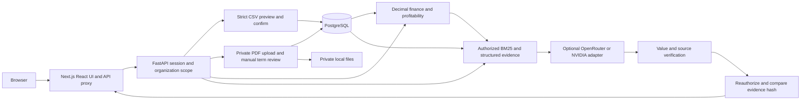
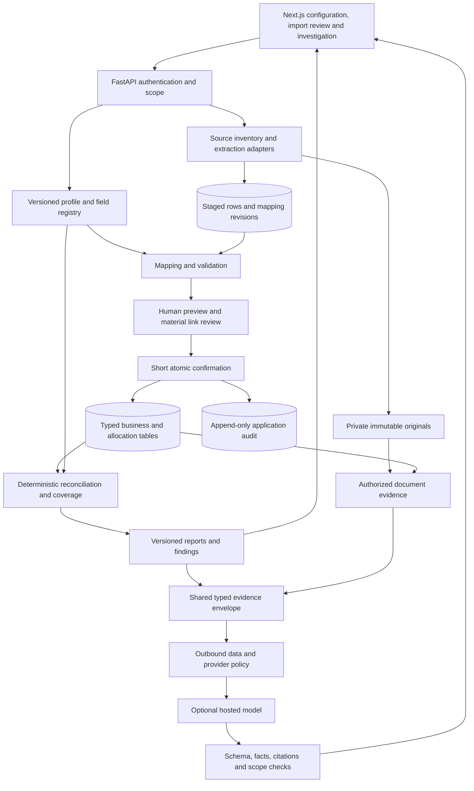

> **Archived expanded proposal — superseded for COM-711.** This is future research, not the current implementation backlog. Use the [active minor-project SRS](../../../../requirements/SRS.md). Historical claims below retain their original audit context.

# ProfitLens target architecture and trust boundaries

15 October 2026 · proposed design, pending review. [Current audit](gap-analysis.md), [canonical ER/data dictionary](canonical-data-model.md), [SRS](../requirements/SRS.md).

## 1. Architecture options

| Option | Benefits | Costs / risks | Decision |
|---|---|---|---|
| Relax current CSV headers and put extras in each record | Small initial patch | Does not solve field meaning, optional ownership, allocations or audited interpretation; unsafe defaults become tempting | Reject as the architecture; preserve strict legacy adapter |
| Typed modular monolith with staged imports and versioned profiles | Reuses FastAPI/Postgres/Next.js, short transactions, enforceable FKs, incremental migrations | Requires explicit schema registry, provenance and compatibility discipline | **Recommend** |
| Generic document/EAV database for all business records | Easy arbitrary field ingestion | Weak financial constraints, expensive joins, unclear lifecycle and permissions | Use JSONB only at boundaries/custom fields, not core financial truth |
| Microservices/event streaming/vector platform | Independent scaling and specialization | Distributed consistency, operational burden, additional secrets/queues | Defer until measured throughput or team boundaries justify it |

Smallest maintainable design: one frontend, one API process/deployment, one PostgreSQL database and private file storage. Introduce a bounded worker only when parsing measurements justify moving CPU/time-heavy jobs out of requests. No Kafka, new model training or separate industry applications.

## 2. Actual current system



This diagram represents existing source code. AI calls are outside database transactions; current access/data are checked after generation. Actual runtime configuration and live model quality are separate validation questions. No pgvector or pretrained embedding model appears because neither is implemented. Database schema/table presence was checked read-only; the diagram is not a fresh E2E certification.

## 3. Proposed system and service boundaries



New logical services live inside the current application: profile registry, source storage, extraction adapters, mapping, typed relationships/allocations, calculation context and shared evidence. A module is a capability with validation and authorization, not a new deployment.

| Boundary | Responsibility / suggested location | What it must not do |
|---|---|---|
| Scope resolver | Extend `security.py`; typed record/document visibility policies | Infer permissions from an LLM or customer name |
| Profile registry | New `organization_config` package; validated immutable versions | Execute arbitrary admin code or relax tenant/money invariants |
| Source/staging | New source tables/storage service; adapters under `ingestion/` | Count staging rows as posted records or discard unknown fields |
| Mapper | Deterministic candidates and reviewed templates | Automatically decide material ambiguous semantics |
| Commit service | Evolve `imports.confirm`; compare versions/hash and transactional writes | Hold org lock during expensive extraction/provider call |
| Relationships | Typed payment/credit/cost/contract links + review metadata | Store authoritative financial links only in unconstrained JSON |
| Calculations | Retain pure `finance`/`profitability`; use interpretation adapters | Change legacy semantics silently or sum incompatible currencies |
| Evidence | Shared envelope for report/search/chat/investigation | Treat retrieved text as trusted instructions or assertions |
| UI | Schema-driven forms with explicit reasons and source preview | Decide financial validity/security solely in browser |

## 4. Staged data-flow diagram

```mermaid
flowchart LR
    SRC[Source files] --> INV[Inventory and type checks]
    INV --> EXT[Extract with coordinates]
    EXT --> NOR[Normalize with raw values retained]
    NOR --> VAL[Field and workflow validation]
    VAL --> MATCH[Candidate links and duplicates]
    MATCH --> PRE[Preview and human review]
    PRE --> OK[Confirmed typed persistence]
    OK --> RECON[Reconcile under versioned rules]
    RECON --> REPORT[Report and inspect evidence]
    VAL --> ERR[Issues requiring correction]
    MATCH --> ERR
    ERR --> PRE
```



Review does not erase original evidence. A correction creates a new mapping/candidate revision. Invalid rows remain staged; only the default atomic batch can confirm. Multi-file jobs have per-file outcomes and explicit dependencies rather than an invisible best-effort partial import.

## 5. Import/reconciliation sequence

```mermaid
sequenceDiagram
    actor F as Finance reviewer
    participant API as Scoped API
    participant S as Source and staging
    participant C as Config and mapper
    participant DB as PostgreSQL
    participant R as Reconciliation
    F->>API: Upload and choose kind/sheets
    API->>API: Authenticate, authorize, enforce limits
    API->>S: Store original and inventory hash
    S->>C: Raw cells and source metadata
    C-->>F: Candidates, unknowns, validation, version
    F->>API: Review mapping and material links
    API->>S: New preview revision and hash
    F->>API: Confirm exact preview
    API->>DB: Begin; lock; reauthorize; verify versions
    alt Config, permissions or records changed
        DB-->>API: Conflict
        API-->>F: 409 and re-preview action
    else Valid immutable preview
        API->>DB: Insert typed records, source links and audit
        API->>DB: Commit once
        API->>R: Evaluate confirmed data and invalidate stale reports
        R-->>F: Totals, coverage, reviewable findings
    end
```

Out-of-transaction file writes use a pending blob manifest. Finalization is idempotent; a recovery job resolves orphan/missing files. A database commit failure cannot be described as a successful import. Derived reports are recomputable; business events and original files are not silently removed.

## 6. Security and authorization boundaries

Browser is untrusted. API resolves session, organization membership, action role and record scope. Database FKs/checks are a second integrity boundary, but current implementation relies on application query scoping rather than demonstrated row-level-security policies. Evaluate RLS later as defense in depth after transaction scope and pooling tests; do not bolt on untested RLS claims.

**New visibility rules:** unallocated expenses, unmatched payments and vendor master details are finance/admin-only initially. Analysts see their permitted customer's allocated slice, not a whole shared cost pool. A document covering multiple customers requires all relevant grants unless an independently reviewed/redacted source slice is stored. Matching candidates and import error previews also contain sensitive data and need authorization. Count/aggregate endpoints must use the same scope.

Model boundary: only allowlisted provider endpoint, minimized permitted context and bounded recent history; organization policy may disable external processing. Never send keys, unrestricted ledgers or unknown sensitive columns. Reject arbitrary tool/URL instructions in source documents, and do not permit financial write tools. Facts and sources are validated, but semantic relevance needs human/benchmark evaluation. Recheck membership, grants and evidence hash after provider latency. Source downloads reauthorize separately.

Upload boundary: follow [OWASP upload guidance](https://cheatsheetseries.owasp.org/cheatsheets/File_Upload_Cheat_Sheet.html). Apply signature and resource limits, parser time budget, safe storage keys and private retrieval. XLSX expansion/formula risks and PDF parser risks require separate fixtures. Consider process isolation before exposing untrusted uploads publicly. General LLM threat categories are documented by [OWASP](https://owasp.org/projects/top-10-for-large-language-model-applications); prompts alone are not a security boundary.

## 7. Configuration example and migration strategy

Illustrative proposed profile fragment (not current configuration syntax):

```json
{
  "schema_version": 1,
  "version": 2,
  "preset_key": "b2b_services",
  "enabled_modules": ["core", "contracts", "cost_allocation"],
  "reporting_currency": "INR",
  "supported_currencies": ["INR"],
  "locale": "en-IN",
  "date_formats": ["yyyy-MM-dd"],
  "timezone": "Asia/Kolkata",
  "accounting_basis": "net_billed_contribution",
  "tax_basis": "source_declared",
  "unallocated_visibility": "finance_admin",
  "mapping_auto_apply": "validated_template_only",
  "outbound_ai": "disabled_until_admin_review"
}
```

1. Back up database and files consistently; verify baseline checksums and safe copied-fixture restore.
2. Add tables and nullable references; seed a legacy-v1 profile, not guessed fields. Preserve current customer grants and source hashes.
3. Add namespaced identity crosswalk; retain old IDs/API shape. Existing source JSON links remain resolvable.
4. Run old/new adapters against the same fixtures; demand exact legacy results. Do not invent invoice lines, issue dates or cash refunds from old aggregate records.
5. Enable new workflow per organization after validation. Configuration changes produce impact preview; stale batches require re-preview.
6. Delay destructive constraint/table removal. Rollback initially means disable new writes/read adapters and retain new data; after new-format writes, an old binary may be incompatible, so use a verified forward repair or maintenance restore rather than claiming effortless downgrade.

## 8. Deployment and operational constraints

Keep frontend/API/DB/files independently configurable but not unnecessarily distributed. Persist private files outside disposable app builds, with DB/file backup pairing, health checks and restricted network access. Public hosting requires HTTPS, secure cookies, proxy body/time limits and bounded parsers. Hosted AI remains optional and failure must not stop deterministic reporting. Performance goals, accessibility, restore rehearsal and security gates are defined in the SRS/testing documents; none is a current production guarantee.
